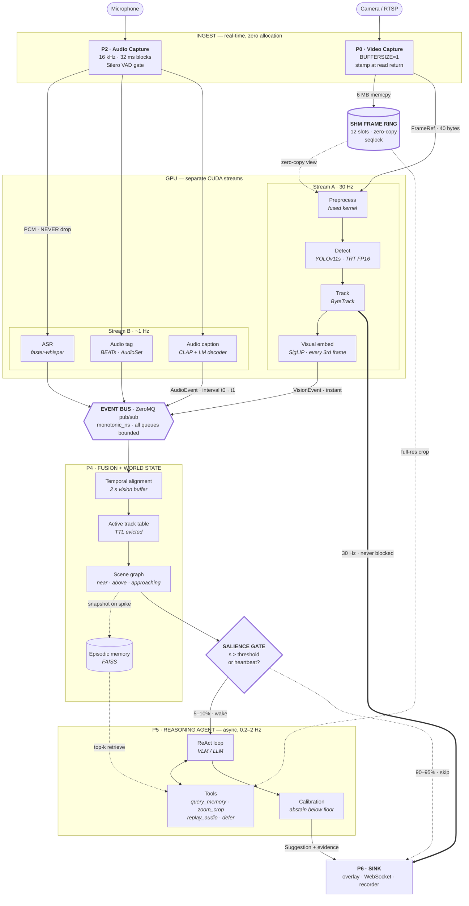

# Real-Time Video Object Detection + Audio Captioning + AI Reasoning

**System architecture**

---

## 1. Design Goals & Constraints

| Goal                         | Target                                | Why it drives the design                                     |
| ---------------------------- | ------------------------------------- | ------------------------------------------------------------ |
| Glass-to-glass video latency | < 100 ms                              | Overlays must feel attached to the scene                     |
| Video throughput             | 30 FPS sustained, no accumulating lag | Frame budget = 33.3 ms                                       |
| Audio caption latency        | < 1.5 s                               | Bounded by ASR context window, not by compute                |
| Reasoning/suggestion latency | < 3 s, non-blocking                   | Must never stall the video path                              |
| Degradation mode             | Drop frames, never drop audio         | Dropped video = jitter. Dropped audio = corrupted transcript |
| Hardware floor               | 1× consumer GPU (8 GB), 8-core CPU    | Forces quantization + careful scheduling                     |

### The Three-Clock Problem

This is the single most important constraint in the system.

```
Video    ──●──●──●──●──●──●──●──●──●──●──●──●──●──●──●──●──●──  30 Hz  (33 ms)
Audio    ──────────●─────────────────●─────────────────●──────   ~1 Hz  (1000 ms window)
Reasoning ─────────────────●───────────────────────────●──────  0.2–2 Hz (event-driven)
```

These cadences are **physically incompatible**:

- Object detection is _per-frame_ and stateless-ish. It wants to run every 33 ms.
- ASR needs **≥ 0.5–1.0 s of acoustic context** to produce a stable transcript. You cannot ask Whisper for a caption of a 33 ms slice; the answer is meaningless. This latency is _inherent to the task_, not a performance bug.
- A VLM/LLM reasoning step costs 300 ms (small local VLM) to 3 s (cloud). Running it per-frame is 100× over budget and burns money for no information gain, because consecutive frames are ~identical.

**Consequence:** the pipeline is not a pipeline. It is a set of independent producers writing into a shared, timestamped world-state, plus consumers that sample that state at their own rate. Anything synchronous couples the slow clock to the fast one and the video path dies.

---

## 2. Topology

```
                          ┌─────────────────────────────┐
   ┌──────────┐  frames   │  SHARED MEMORY RING BUFFER  │
   │ P0       │──────────>│  (N slots, zero-copy)       │
   │ Video    │           └──────────────┬──────────────┘
   │ Capture  │  descriptors             │ slot_id, ts, shape
   └──────────┘─────────┐                │
                        ▼                ▼
                  ┌──────────────────────────┐
                  │ P1  Video Inference (GPU)│
                  │  preprocess → detect     │
                  │  → track → embed         │
                  └────────────┬─────────────┘
                               │ DetectionEvent(ts, tracks[], clip_emb)
                               ▼
   ┌──────────┐         ┌═══════════════════════════════════┐
   │ P2       │         ║      EVENT BUS  (async, ZeroMQ)   ║
   │ Audio    │────────>║   timestamped, monotonic clock    ║
   │ Capture  │ PCM     ╚═══════════╤═══════════════════╤═══╝
   │  + VAD   │  chunks             │                   │
   └────┬─────┘                     │                   │
        │                           ▼                   │
        │                 ┌──────────────────┐          │
        │  speech         │ P4  Fusion +     │          │
        └───────────────> │     World State  │          │
                          │  (temporal align)│          │
   ┌──────────┐  Audio    │  + Scene Graph   │          │
   │ P3       │  Event    │  + Episodic Mem  │          │
   │ Audio    │──────────>└────────┬─────────┘          │
   │ Inference│                    │                    │
   │ ASR+tags │           salience │ gate               │
   │ +caption │                    ▼                    │
   └──────────┘           ┌──────────────────┐          │
                          │ P5  Reasoning    │          │
                          │  Agent (VLM/LLM) │          │
                          │  analysis+advice │          │
                          └────────┬─────────┘          │
                                   │ Suggestion         │
                                   ▼                    ▼
                          ┌────────────────────────────────┐
                          │ P6  Sink: overlay / WebSocket  │
                          │      / WebRTC / recorder       │
                          └────────────────────────────────┘
```

---

## 3. Process & Concurrency Model

**Processes, not threads.** CPython's GIL means a threaded design serializes preprocessing, NMS, tracking, and postprocessing against each other. Use `multiprocessing` with `spawn` start method (CUDA + `fork` corrupts context).

| Proc | Role                                      | Bound by               | Placement                            |
| ---- | ----------------------------------------- | ---------------------- | ------------------------------------ |
| P0   | Video capture, decode                     | I/O + memcpy           | CPU core 0, pinned                   |
| P1   | Detect + track + visual embed             | GPU                    | GPU stream A                         |
| P2   | Audio capture, VAD gating, ring buffering | I/O (real-time thread) | CPU core 1, `SCHED_FIFO` if possible |
| P3   | ASR + audio tagging + captioning          | GPU                    | GPU stream B                         |
| P4   | Fusion, world state, salience gate        | CPU (light)            | asyncio, single core                 |
| P5   | Reasoning agent                           | Network / GPU          | asyncio, high concurrency            |
| P6   | Sink / render                             | GPU or network         | —                                    |

### Why the video path must not pickle frames

A 1080p BGR frame is 6.2 MB. Sending it through `multiprocessing.Queue` means pickle → pipe → unpickle: measured **8–15 ms per frame**, i.e. up to half your entire frame budget, spent on _moving bytes you already had_.

**Fix:** frames live in a preallocated `multiprocessing.shared_memory` ring buffer. Only a 40-byte descriptor crosses the queue.

```python
# core/ringbuffer.py  (sketch)
from multiprocessing import shared_memory
import numpy as np
from dataclasses import dataclass

@dataclass(frozen=True, slots=True)
class FrameRef:
    slot: int              # index into ring
    ts_mono_ns: int        # capture timestamp, time.monotonic_ns()
    seq: int               # monotonically increasing frame number
    shape: tuple           # (H, W, C)
    dtype: str

class FrameRing:
    """Preallocated SHM ring. Producer overwrites oldest slot. No locks on
    the data plane; correctness comes from the fact that the consumer is
    always >= 2 slots behind, and stale reads are detected via `seq`."""

    def __init__(self, slots: int, shape: tuple, dtype=np.uint8, create=True, name=None):
        self.slots, self.shape = slots, shape
        nbytes = slots * int(np.prod(shape)) * np.dtype(dtype).itemsize
        self.shm = shared_memory.SharedMemory(create=create, size=nbytes, name=name)
        self.buf = np.ndarray((slots, *shape), dtype=dtype, buffer=self.shm.buf)
        self._i = 0

    def write(self, frame: np.ndarray, ts: int, seq: int) -> FrameRef:
        slot = self._i % self.slots
        self.buf[slot] = frame                  # single memcpy, ~1.5 ms @1080p
        self._i += 1
        return FrameRef(slot, ts, seq, frame.shape, str(frame.dtype))

    def read(self, ref: FrameRef) -> np.ndarray:
        return self.buf[ref.slot]               # zero-copy view
```

Size the ring at `slots >= 3 × (max consumer latency / frame period)`. For 30 FPS and a 60 ms worst-case consumer, ≥ 6 slots. Round up to 12; RAM is cheap, torn reads are not.

**Sizing rule:** if the consumer ever falls more than `slots` frames behind, the producer overwrites a slot being read. The consumer detects this by re-checking `seq` after read and discarding on mismatch (seqlock pattern). Never block the producer.

---

## 4. Data Plane: The Event Contract

Everything on the bus is timestamped against a single monotonic clock captured at ingest. **Never use wall-clock time** — NTP steps will make your fusion window jump backwards.

```python
# core/events.py
@dataclass(frozen=True, slots=True)
class Track:
    track_id: int
    cls: str
    conf: float
    bbox: tuple[float, float, float, float]   # xyxy, normalized
    velocity: tuple[float, float]             # px/s, from tracker's Kalman state
    age_frames: int

@dataclass(frozen=True, slots=True)
class VisionEvent:
    ts_mono_ns: int
    seq: int
    tracks: list[Track]
    frame_emb: np.ndarray | None    # CLIP/SigLIP, L2-normalized, fp16

@dataclass(frozen=True, slots=True)
class AudioEvent:
    ts_start_ns: int
    ts_end_ns: int                  # window bounds — audio events span time
    transcript: str | None          # ASR, may be None if no speech
    is_final: bool                  # streaming ASR: partial vs committed
    tags: list[tuple[str, float]]   # AudioSet-style: [("dog_bark", 0.87), ...]
    caption: str | None             # "a dog barks while a car passes"
    audio_emb: np.ndarray | None    # CLAP, L2-normalized

@dataclass(frozen=True, slots=True)
class Suggestion:
    ts_mono_ns: int
    text: str
    confidence: float
    evidence: list[str]             # event ids the reasoner cited
    abstained: bool
```

Note `AudioEvent` carries a **start and end** timestamp. Vision events are instants; audio events are intervals. Fusion must handle this asymmetry — an audio caption covering `[t-1000ms, t]` should be aligned against the _set_ of vision events in that interval, not the single nearest one.

---

## 5. Component Specifications

### P0 — Video Capture

- `cv2.VideoCapture` with `CAP_PROP_BUFFERSIZE=1`. Without this, OpenCV/FFmpeg buffers frames internally and you accumulate seconds of hidden latency that no profiler will show you.
- For RTSP/production: prefer PyAV or GStreamer with `appsink drop=true max-buffers=1`, or NVDEC hardware decode via DeepStream / VPF.
- Timestamp **at the moment of `read()` return**, not after preprocessing.

### P1 — Video Inference

**Preprocess on GPU.** Letterbox + BGR→RGB + normalize + HWC→CHW costs 4–6 ms on CPU with NumPy, ~0.4 ms as a fused CUDA kernel. Use `torchvision.transforms.v2` on a GPU tensor, or fold normalization into the model's first layer at export time (best — zero extra kernels).

**Detector options:**

| Model                  | Latency (640², T4, FP16) | mAP            | Open-vocab | When to pick               |
| ---------------------- | ------------------------ | -------------- | ---------- | -------------------------- |
| YOLOv11n/s             | 3–8 ms                   | 39–47          | ✗          | Fixed classes, max speed   |
| RT-DETR-R18            | 12 ms                    | 46.5           | ✗          | NMS-free, cleaner postproc |
| YOLO-World-S           | 15 ms                    | 37 (zero-shot) | ✓          | Classes defined at runtime |
| OWLv2 / Grounding DINO | 80–200 ms                | high           | ✓          | Offline / keyframe-only    |

Export to **TensorRT FP16** (or ONNX Runtime + CUDA EP if you need portability). Typical speedup over eager PyTorch: 2.5–4×. INT8 with calibration gets another 1.4× at ~1 mAP cost — usually worth it.

> Verify current model versions and benchmark numbers before committing. This space moves fast and the table above reflects a snapshot, not gospel. Benchmark on _your_ hardware with _your_ input resolution — vendor numbers are best-case.

**Tracking:** ByteTrack (association on both high- and low-confidence boxes) or BoT-SORT (adds ReID + camera-motion compensation). Cost: < 1 ms CPU. This is not optional.

> **Why tracking is load-bearing.** Per-frame detection flickers: an object at conf 0.48 appears and vanishes across consecutive frames. A downstream reasoner fed raw detections will hallucinate events ("a knife appeared and disappeared 6 times"). The tracker's Kalman filter is a _temporal prior_ that turns a noisy per-frame classifier into a stable object identity. Every "object permanence" property the reasoning layer assumes is manufactured here.

### P2 — Audio Capture + VAD

- `sounddevice.InputStream`, 16 kHz mono, 32 ms blocks (512 samples). Callback writes to a lock-free ring; **never allocate, log, or call into Python objects inside the audio callback** — a GC pause there produces an audible glitch and a corrupted transcript.
- **Silero VAD** on each 32 ms block (~0.3 ms CPU). Gate the expensive ASR: typical conversation is 30–50% speech, so VAD alone halves ASR cost.
- Maintain a 30 s rolling PCM buffer so the reasoner can request "replay the last 5 seconds" for a second-pass, higher-quality transcription.

### P3 — Audio Inference

Three distinct heads on the same audio window:

1. **ASR (speech → text).** `faster-whisper` (CTranslate2 backend), `small.en` or `distil-large-v3`, INT8. Window: 1.0 s chunk with 0.3 s overlap. Emit `is_final=False` partials immediately; commit to `is_final=True` when VAD reports 400 ms of trailing silence or the window slides past. NVIDIA Parakeet/Canary are strong alternatives with genuinely streaming-native architectures.

2. **Audio tagging (non-speech events).** PANNs / BEATs / AST over a 1 s window → AudioSet's 527 classes. ~10–20 ms. This is what gives you `("glass_breaking", 0.91)`.

3. **Audio captioning (natural-language description).** A sequence model over audio embeddings (EnCLAP, Pengi, or a CLAP-encoder + small LM decoder). This is a _different task_ from ASR: ASR answers "what words were said," captioning answers "what is happening acoustically."

> **The distinction matters and is frequently conflated.** "Audio caption" ≠ "transcript." If someone says _"look out!"_ while a car screeches, ASR gives you `"look out"` and captioning gives you `"a vehicle skids on asphalt as a person shouts."` The reasoning layer needs both; they carry orthogonal information. If you only implement ASR you have built subtitles, not audio understanding.

Run P3 on a **separate CUDA stream** from P1, or on a second device if available. Whisper and YOLO contending for the same stream serializes them and blows the video budget.

### P4 — Fusion + World State

Maintains:

- **Active track table** — `track_id → {cls, first_seen, last_seen, trajectory}`, TTL-evicted.
- **Scene graph** — nodes = tracks, edges = spatial predicates computed from bboxes: `near`, `above`, `contains`, `approaching` (from velocity), `occludes`. Cheap (< 2 ms for < 30 objects) and it is what converts a bag of boxes into something an LLM can reason over.
- **Episodic memory** — every N seconds _or_ on salience spike, snapshot `(frame_emb, audio_emb, scene_graph, caption)` into a FAISS/Qdrant index. Enables "have I seen this before?" and RAG over the session's own history.

**Temporal alignment.** Audio event `[t0, t1]` aligns to all vision events with `t0 ≤ ts ≤ t1`. Because ASR lags ~1 s, the vision events it should align with are _already in the past_. Buffer vision events for ≥ 2 s so late-arriving audio can find its partners. Do not align on arrival order.

---

## 6. The Salience Gate

This is the highest-leverage component in the entire system, and the one most designs omit.

A VLM call is ~10⁴× more expensive than a detection. Consecutive frames are near-identical. Calling the reasoner every frame means paying 10⁴× for ~0 bits of new information.

**Only wake the reasoner when the world has actually changed.**

```python
# core/salience.py
def salience(prev: WorldState, cur: WorldState, cfg) -> float:
    s = 0.0
    # 1. New object identities (tracker gives us this for free)
    s += cfg.w_new_track * len(cur.track_ids - prev.track_ids)
    # 2. Class-set change  (a *knife* entered a *kitchen* scene)
    s += cfg.w_new_class * len(cur.classes - prev.classes)
    # 3. Visual drift: cosine distance on CLIP embedding
    s += cfg.w_visual * (1.0 - float(cur.frame_emb @ prev.frame_emb))
    # 4. Salient audio: any tag above threshold that wasn't there before
    s += cfg.w_audio * sum(c for t, c in cur.audio_tags
                           if c > cfg.tag_thresh and t not in prev.audio_tag_set)
    # 5. Kinematic: any track accelerating hard (fall, collision, sudden motion)
    s += cfg.w_kinematic * max((t.accel_mag for t in cur.tracks), default=0.0)
    return s

def should_reason(s: float, cfg, last_call_ns: int, now_ns: int) -> bool:
    heartbeat = (now_ns - last_call_ns) > cfg.heartbeat_ns   # never go fully silent
    return s > cfg.threshold or heartbeat
```

Empirically this cuts VLM invocations by **~90–95%** on typical continuous video, with essentially no loss in event recall — because the events you care about _are exactly the moments of high salience_. The heartbeat term guarantees the system still speaks during long static stretches.

Tune `threshold` on a labeled clip by sweeping it against (VLM calls saved) vs (annotated events missed). It is a precision/recall knob, and it is the knob that determines whether this system costs $5/day or $500/day to run.

---

## 7. AI Concepts in the Reasoning Layer

You asked for real-time analysis and suggestion. These are the techniques that make that more than a captioning demo, roughly ordered by value-per-unit-effort.

### 7.1 Open-vocabulary detection

YOLO-World / OWLv2 accept a **text prompt list at inference time**. Users type "hard hat, exposed wire, spill" and the detector adapts with zero retraining. Precompute and cache the text embeddings once at prompt-change time; per-frame cost is then a single matmul against the image features.

### 7.2 Scene graphs as LLM interface

Do not feed raw boxes to the LLM. Feed relations:

```
person#3 --holds--> knife#7
person#3 --near--> stove#1        (dist 0.4m, closing at 0.8 m/s)
audio: ["sizzling" 0.93, "speech" 0.71]
```

This is ~30× fewer tokens than a box list, and the model reasons far better over it because relations are what the question is actually about. Serialize deterministically (sorted by track_id) so responses are cacheable.

### 7.3 Cross-modal embedding alignment

CLIP embeds images; CLAP embeds audio; both can be projected into a comparable space. Compute `cos(frame_emb, audio_emb)` continuously. A sustained **drop** means video and audio disagree — the classic signature of an off-screen event ("I hear breaking glass but see nothing"). That's a free, model-agnostic anomaly signal, and it's often the most interesting thing in the stream.

### 7.4 Streaming anomaly detection

Fit a running mean/covariance over the frame-embedding stream (Welford's algorithm, O(1) memory). Score each new embedding by Mahalanobis distance; alert past a z-threshold. Upgrade path: `river`'s `HalfSpaceTrees` for a proper online model. Start with the z-score — it works surprisingly well and takes 20 lines.

### 7.5 Episodic memory + RAG

Every salience spike writes `(embedding, timestamp, scene_graph, caption)` to a vector index. Before reasoning, retrieve the k nearest past snapshots. Now the reasoner can say _"this is the third time in 10 minutes the machine has jammed at this station"_ — the single capability that separates a perception system from an analysis system.

### 7.6 Agentic suggestion loop

The reasoner is a ReAct-style agent with tools, not a single prompt:

| Tool                    | Purpose                                                               |
| ----------------------- | --------------------------------------------------------------------- |
| `query_memory(text, k)` | RAG over episodic memory                                              |
| `zoom_crop(track_id)`   | Re-run VLM on a cropped high-res region — recover detail lost at 640² |
| `replay_audio(t0, t1)`  | Second-pass ASR with a larger model on a specific window              |
| `get_track_history(id)` | Full trajectory + class-confidence history                            |
| `defer()`               | Explicitly decline to suggest                                         |

`zoom_crop` is worth calling out: your detector runs at 640×640, so a face, label, or gauge reading is a handful of pixels. When the agent needs that detail, it re-crops from the _full-resolution_ frame still sitting in the ring buffer. Cheap, and it recovers most of the accuracy you gave up to hit 30 FPS.

### 7.7 Calibration + abstention

Neural nets are overconfident, and detection confidence is not probability. Fit **temperature scaling** on a held-out set (one scalar parameter, 10 lines of code, well-founded). Then enforce: below a calibrated-confidence floor the agent must call `defer()` rather than guess.

A system that says "I'm not sure" is strictly more useful than one that is fluently wrong — especially in the safety-adjacent contexts this architecture invites. Treat abstention as a first-class output, not a failure.

### 7.8 Active learning / hard-example mining

Log frames where (a) detection confidence sits in `[0.35, 0.55]`, (b) the tracker breaks an identity, or (c) the anomaly score spikes. These are your labeling queue. This closes the loop: the deployed system generates its own training data, ranked by informativeness.

---

## 8. Latency Budget

Per-frame video path, 640² input, RTX 3060-class, TensorRT FP16:

| Stage            | Budget     | Notes                                        |
| ---------------- | ---------- | -------------------------------------------- |
| Capture + decode | 5 ms       | `BUFFERSIZE=1` mandatory                     |
| SHM write        | 1.5 ms     | 1080p memcpy                                 |
| GPU preprocess   | 0.5 ms     | fused kernel                                 |
| Detection        | 8 ms       | YOLOv11s                                     |
| NMS              | 1 ms       | on-GPU, or use RT-DETR to skip               |
| Tracking         | 1 ms       | CPU, ByteTrack                               |
| Visual embedding | 4 ms       | SigLIP-B, every 3rd frame → amortized 1.3 ms |
| Scene graph      | 2 ms       | < 30 objects                                 |
| Render / encode  | 3 ms       |                                              |
| **Total**        | **~23 ms** | **~10 ms headroom at 30 FPS**                |

Audio path (off the critical path):

| Stage                                     | Latency                                             |
| ----------------------------------------- | --------------------------------------------------- |
| VAD                                       | 0.3 ms / 32 ms block                                |
| ASR (`distil-large-v3`, INT8, 1 s window) | ~120 ms compute                                     |
| Audio tagging                             | 15 ms                                               |
| Audio captioning                          | ~200 ms                                             |
| **Perceived caption latency**             | **~1.2 s** — dominated by the _window_, not compute |

Reasoning path: 0.3–3 s, fully async, gated to ~0.2–2 Hz. **Never blocks anything.**

---

## 9. Backpressure Policy

Different modalities need _opposite_ drop policies. Getting this backwards is the most common way this architecture fails in production.

| Queue                | Policy                                          | Rationale                                                                                                      |
| -------------------- | ----------------------------------------------- | -------------------------------------------------------------------------------------------------------------- |
| Capture → Detect     | **Drop oldest** (`maxsize=2`)                   | Latest frame wins. A stale detection is worse than no detection                                                |
| Audio callback → ASR | **Never drop; block-free ring, grow if needed** | A 100 ms audio gap corrupts the transcript across the whole utterance. Audio is not resamplable after the fact |
| Fusion → Reasoning   | **Coalesce** (`maxsize=1`, replace)             | If the agent is busy, the next request should carry the _newest_ world state, not a queued stale one           |
| Reasoning → Sink     | Bounded, drop oldest                            | Suggestions expire                                                                                             |

**Hard rule: no unbounded queues anywhere.** An unbounded queue does not prevent overload; it converts a fast, visible failure into a slow OOM 40 minutes into a demo.

---

## 10. Failure Modes

| Failure                    | Symptom                                 | Mitigation                                                                                               |
| -------------------------- | --------------------------------------- | -------------------------------------------------------------------------------------------------------- |
| Hidden decoder buffering   | Latency grows, FPS looks fine           | `CAP_PROP_BUFFERSIZE=1`; measure glass-to-glass with a clock in-frame, not with `time()` around `read()` |
| CUDA contention P1↔P3      | Both slow, GPU util < 60%               | Separate streams; pin audio to second GPU if present                                                     |
| GC pause in audio callback | Audible clicks, garbage transcript      | No allocation in callback; preallocate; consider `gc.freeze()` after warmup                              |
| Wall-clock NTP step        | Fusion window jumps backward            | `time.monotonic_ns()` exclusively                                                                        |
| Ring buffer torn read      | Corrupted frame, rare, nondeterministic | Seqlock: re-check `seq` post-read, discard on mismatch                                                   |
| Tracker ID switches        | Reasoner reports phantom object churn   | BoT-SORT + ReID; log switches as an active-learning signal                                               |
| VLM cost explosion         | Bill, or rate-limit stalls              | Salience gate + hard token budget per minute                                                             |
| Overconfident suggestion   | Fluent, wrong, acted upon               | Temperature scaling + mandatory `defer()` below threshold                                                |
| Silent model degradation   | Accuracy drifts, nobody notices         | Log detection-confidence histogram; alert on distribution shift                                          |

---

## 11. Observability

Instrument from day one; retrofitting timing into a multiprocess pipeline is miserable.

- **Per-stage histograms** (`prometheus_client`): capture, preprocess, infer, nms, track, fuse, reason.
- **Queue depths** as gauges. Sustained depth > 1 anywhere = that stage is the bottleneck.
- **`seq` gap counter** — how many frames were dropped, and where.
- **Trace a sampled 1% of frames end-to-end** with an OpenTelemetry span carried on the `FrameRef`.
- **Salience-gate hit rate** and VLM tokens/minute. These are your cost dashboards.

Glass-to-glass measurement: point the camera at a millisecond-precision on-screen clock, capture the rendered overlay, diff the timestamps. Everything else lies.

---

## 12. Repository Layout

```
rt-perception/
├── core/
│   ├── ringbuffer.py       # SHM frame ring (seqlock)
│   ├── events.py           # frozen dataclasses; the wire contract
│   ├── bus.py              # ZeroMQ pub/sub, monotonic timestamps
│   └── salience.py         # the gate
├── video/
│   ├── capture.py          # P0
│   ├── detect.py           # P1: TRT engine wrapper
│   ├── track.py            # ByteTrack / BoT-SORT
│   └── embed.py            # SigLIP, every-Nth-frame
├── audio/
│   ├── capture.py          # P2: sounddevice + Silero VAD
│   ├── asr.py              # faster-whisper streaming
│   ├── tag.py              # PANNs / BEATs
│   └── caption.py          # CLAP encoder + LM decoder
├── fusion/
│   ├── state.py            # P4: world state, track table
│   ├── scene_graph.py      # spatial predicates
│   └── memory.py           # FAISS episodic index
├── reasoning/
│   ├── agent.py            # P5: ReAct loop
│   ├── tools.py            # zoom_crop, query_memory, replay_audio, defer
│   ├── calibration.py      # temperature scaling
│   └── prompts/
├── sinks/
│   ├── overlay.py          # cv2 / pyglet
│   └── websocket.py        # FastAPI + WS for remote UI
├── bench/
│   ├── latency.py          # glass-to-glass harness
│   └── gate_sweep.py       # salience threshold vs recall
├── configs/default.yaml
└── main.py                 # process supervisor
```

---

## 13. Configuration Sketch

```yaml
video:
    source: 0
    size: [640, 640]
    ring_slots: 12
    detector:
        engine: models/yolov11s_fp16.engine
        conf: 0.35
        open_vocab: false
        classes: null # set a list to enable YOLO-World prompts
    tracker: { type: bytetrack, track_buffer: 30 }
    embed: { model: siglip-base, every_n_frames: 3 }

audio:
    sample_rate: 16000
    block_ms: 32
    vad: { model: silero, threshold: 0.5, min_silence_ms: 400 }
    asr:
        {
            model: distil-large-v3,
            compute_type: int8,
            window_s: 1.0,
            overlap_s: 0.3,
        }
    tagging: { model: beats, window_s: 1.0, threshold: 0.3 }
    captioning: { enabled: true, window_s: 2.0 }

fusion:
    vision_buffer_s: 2.0 # must exceed ASR lag
    scene_graph: { near_thresh_norm: 0.15 }
    memory: { backend: faiss, dim: 768, snapshot_on_salience: true }

salience:
    threshold: 1.2
    heartbeat_s: 20.0
    weights:
        {
            new_track: 0.5,
            new_class: 1.0,
            visual: 2.0,
            audio: 1.5,
            kinematic: 0.8,
        }

reasoning:
    provider: anthropic # or local: qwen2-vl-7b
    max_concurrent: 2
    token_budget_per_min: 8000
    abstain_below_confidence: 0.55
    tools: [query_memory, zoom_crop, replay_audio, get_track_history, defer]
```

---

## 14. Key Decisions, Restated

1. **Three clocks, decoupled by an event bus.** Any synchronous call from the video path into ASR or the LLM destroys the system.
2. **Zero-copy frames via shared memory.** Pickling 6 MB frames costs half your frame budget.
3. **Tracking is not optional** — it is the temporal prior that makes downstream reasoning coherent.
4. **The salience gate is the product.** It is what makes continuous LLM reasoning economically possible.
5. **Audio captioning ≠ ASR.** Build both; they carry orthogonal information.
6. **Opposite backpressure policies** for video (drop) and audio (never drop).
7. **Abstention is a feature.** Calibrate, then let the agent decline.


